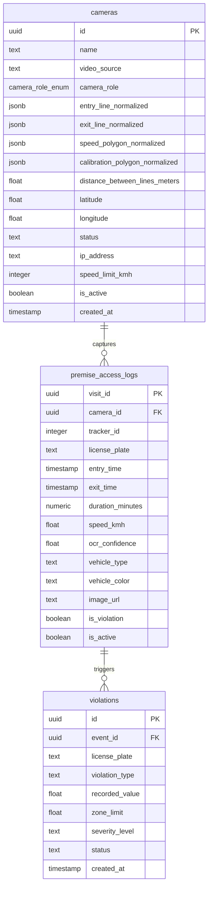
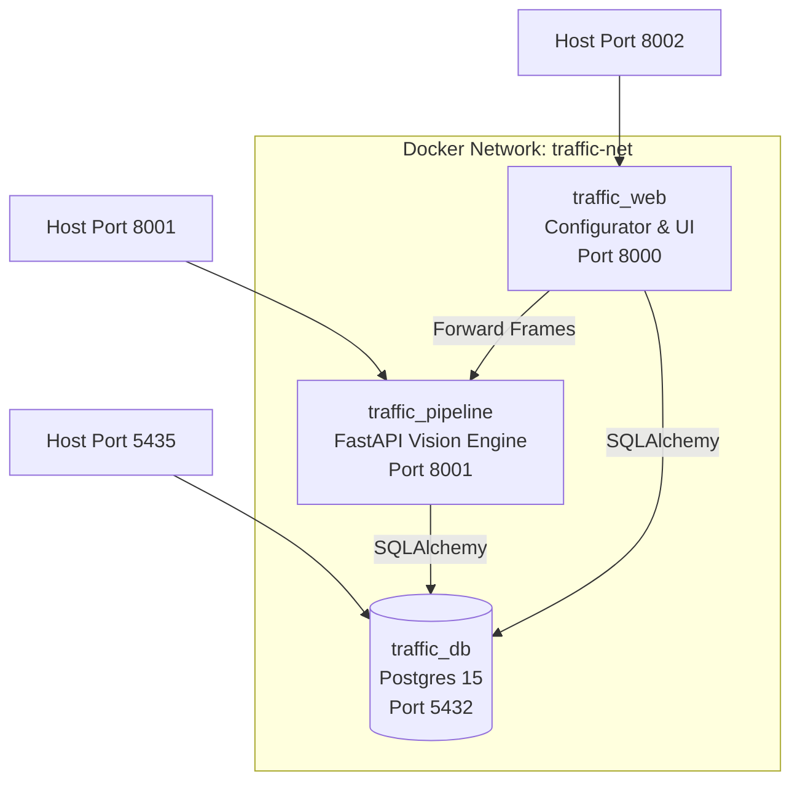

# Technical Codebase Documentation: Traffic_CV

**Production Vehicle Access Logging & Automated Number Plate Recognition System**  
**Version:** 2.4.0 (Production Release)  
**Deployment Profile:** 100% On-Premise / Centralized Server Architecture  
**Primary Target:** Campus & Facility Vehicle Access Control (e.g., VNR VJIET Layout)

---

## 1. System Overview & Production Constraints

`Traffic_CV` is an enterprise-grade Computer Vision and Access Control platform engineered to monitor, log, and audit vehicle entries, exits, speeds, and license plates in real time.

### Core System Principles (from Production Directives)
1. **100% Local / On-Premise Infrastructure**: Zero cloud dependencies. No external API calls, third-party cloud storage (S3/GCS), or SaaS inference services. All AI inference (YOLO, ByteTrack, PaddleOCR) and data persistence (PostgreSQL / SQLite) occur strictly on local servers.
2. **Centralized High-Throughput Processing**: Architecture is engineered for dedicated on-premise compute servers (multi-core CPU / NVIDIA GPU workstations), avoiding edge bottlenecks (e.g. Raspberry Pi / Jetson Nano).
3. **Accurate Timestamping & Gate State Management**: Strict line-crossing triggers (`sv.LineZone`) monitor arrival and departure times, logging entry/exit intervals and premise dwell duration.
4. **Industrial-Grade License Plate Accuracy**: Multi-frame consensus voting, morphological candidate extraction, LAB CLAHE enhancement, and Indian vehicle registration regex corrections ensure reliable character capture under glare, motion blur, and low lighting.
5. **Database as Ground Truth**: The local PostgreSQL database is the single source of truth for live system states, access audits, camera configurations, and safety violations.

---

## 2. Repository Structure

```
Traffic_CV/
├── .agents/                               # Production development rules & architectural constraints
│   └── AGENTS.md
├── dashboard/                             # Frontend Control Center (React 18 + Vite + TypeScript)
│   ├── src/
│   │   ├── components/                    # UI primitives, charts, modals, layout components
│   │   │   ├── analytics/                 # TrafficLineChart, VehicleTypeDonut, ViolationBarChart
│   │   │   ├── dashboard/                 # AlertsPanel, LiveEventsTable, StatCardsGrid
│   │   │   ├── layout/                    # AppHeader, AppSidebar, RootLayout
│   │   │   ├── tracking/                  # CameraDetailsCard, LastSeenCard, MapContainer
│   │   │   └── ui/                        # Radix UI primitives (Button, Card, Dialog, Table, etc.)
│   │   ├── hooks/                         # TanStack Query data-fetching hooks (use-events, use-cameras, etc.)
│   │   ├── lib/                           # State store (Zustand) & utility functions
│   │   ├── pages/                         # DashboardPage, PipelinePage, ConfiguratorPage, TrackingPage, AnalyticsPage
│   │   ├── types/                         # TypeScript interfaces for API models
│   │   ├── App.tsx                        # Client-side router & providers
│   │   └── main.tsx                       # React DOM root entry
│   ├── package.json                       # Frontend dependencies
│   └── vite.config.ts                     # Vite build configuration (outputs to static/)
├── mobile_stream/                         # Zero-latency mobile camera streaming subsystem
│   ├── setup_mobile_stream.py             # Interactive CLI & LAN stream probing wizard
│   ├── stream_tester.py                   # Latency, FPS, and jitter benchmarking tool
│   └── README.md                          # Mobile RTSP / Larix / IP Webcam integration manual
├── static/                                # Built static distribution of dashboard + phone stream UI
│   ├── assets/                            # Compiled JS bundles and CSS stylesheets
│   ├── index.html                         # SPA index serving React dashboard
│   └── phone.html                         # Mobile WebPush camera transmitter (<50ms latency)
├── .dockerignore                          # Build exclusion rules
├── .env.example                           # Sample environment configuration
├── .gitignore                             # Git ignore rules (excludes models, datasets, test media, logs)
├── annotate_*.py                          # ANPR visual verification and evaluation scripts
├── benchmark_perfect_indian.py            # Standalone benchmark against Indian license plate datasets
├── cert.pem                               # Self-signed SSL certificate for local HTTPS/WSS mobile feeds
├── key.pem                                # SSL private key
├── database.py                            # SQLAlchemy engine, connection pooling, schema migrations, seed logic
├── docker-compose.yml                     # 3-tier multi-container orchestration (db, pipeline, web)
├── Dockerfile                             # Python 3.10 slim container definition with OpenCV & C++ build tools
├── models.py                              # SQLAlchemy ORM definitions (Camera, PremiseAccessLog, Violation)
├── pipeline_api.py                        # Core Computer Vision inference engine (FastAPI, YOLO, ByteTrack, OCR)
├── requirements.txt                       # Locked production Python dependencies
├── schema.sql                             # Canonical PostgreSQL DDL schema with spatial & camera seed data
├── set_mobile_stream.py                   # Root wrapper for mobile camera configuration
├── speed_estimator.py                     # Perspective homography, smoothing, and vehicle speed estimation
├── utils.py                               # Shared ANPR post-processing, candidate extractor, DB flush routines
├── validate_anpr.py                       # XML annotation validation suite (PASCAL VOC / Levenshtein accuracy)
└── web_ui.py                              # FastAPI backend for dashboard API, video upload, and ROI configurator
```

---

## 3. High-Level System Architecture

```
                  ┌────────────────────────────────────────────────────────┐
                  │                 Video Ingestion Layer                  │
                  │  - RTSP Streams (IP Cameras via FreshFrameReader)      │
                  │  - Mobile Streams (WebSocket/HTTP via PushBuffer)      │
                  │  - Local MP4 / Video Files (File VideoCapture)         │
                  └───────────────────────────┬────────────────────────────┘
                                              │ Raw BGR Frames
                                              ▼
                  ┌────────────────────────────────────────────────────────┐
                  │          Perception & Tracking (pipeline_api.py)       │
                  │  1. 640x360 Fast Inference (YOLO11n CPU / YOLO11m GPU) │
                  │  2. Detection Caching (every 2nd frame)                │
                  │  3. Multi-Object Tracking (Supervision ByteTrack)      │
                  └─────────────┬──────────────────────────┬───────────────┘
                                │ Vehicle Bounding Boxes   │ Track Center Points
                                ▼                          ▼
┌───────────────────────────────────────────────┐  ┌─────────────────────────────────────┐
│             ANPR Subsystem                    │  │       Speed & Spatial Subsystem     │
│ 1. Laplacian Sharpness Gate (>10.0)           │  │ 1. Polygon Zone Check (PolygonZone) │
│ 2. Candidate Extraction (Sobel/Morphology)    │  │ 2. 4-Point Homography Projection    │
│ 3. Plate Enhancement (CLAHE + Bicubic Scale)  │  │ 3. Coordinate EMA Smoothing (α=0.6) │
│ 4. Asynchronous PaddleOCR Queue               │  │ 4. Instantaneous Velocity Window    │
│ 5. Multi-Frame Consensus (Levenshtein Cluster)│  │ 5. Entry / Exit LineZone Triggers   │
└───────────────────────┬───────────────────────┘  └──────────────────┬──────────────────┘
                        │ Best Plate Text                             │ Speed / Cross Events
                        └───────────────────────┬─────────────────────┘
                                                │
                                                ▼
                  ┌────────────────────────────────────────────────────────┐
                  │            Access Control & State Management           │
                  │  - Stale Session Flush (after 45 dead frames)          │
                  │  - Speeding & Blacklist Violation Detection            │
                  │  - PostgreSQL / SQLite Storage (database.py)           │
                  └───────────────────────────┬────────────────────────────┘
                                              │
                       ┌──────────────────────┴──────────────────────┐
                       ▼                                             ▼
       ┌───────────────────────────────┐             ┌───────────────────────────────┐
       │   Live MJPEG Video Stream     │             │    Management & Analytics     │
       │   Port 8001 (/api/stream/{id})│             │    Port 8000/8002 (web_ui.py) │
       │   1280x720 Overlay Display    │             │    React Control Dashboard    │
       └───────────────────────────────┘             └───────────────────────────────┘
```

---

## 4. Computer Vision & Perception Engine

### 4.1 Ingestion Subsystem
The engine handles heterogeneous video sources via two zero-lag abstractions in [`pipeline_api.py`](file:///c:/Internship/Trafffic-Analytics/Traffic_CV/pipeline_api.py):

*   **`FreshFrameReader`**: Designed for RTSP/HLS camera streams.
    *   Applies aggressive FFmpeg TCP parameters:
        ```python
        os.environ["OPENCV_FFMPEG_CAPTURE_OPTIONS"] = (
            "rtsp_transport;tcp|fflags;nobuffer|flags;low_delay|"
            "max_delay;100000|reorder_queue_size;0|stimeout;3000000|buffer_size;1024000"
        )
        ```
    *   A dedicated background polling thread continuously executes `cap.grab()` and drains internal driver queues so `read()` always returns the latest frame.
    *   Watchdog monitor: Automatically reconnects on video stalls (>4 seconds without frames) and fails over to HLS backup streams where applicable.
*   **`PushBuffer`**: Designed for mobile browser cameras.
    *   Receives JPEG binary payloads through `/api/camera/ws-push` (WebSocket with bi-directional ACKs) or `/api/camera/push` (HTTP POST).
    *   Calculates live FPS and dropped frame counters with thread-safe atomic access.

### 4.2 Object Detection & Tracking
*   **Dynamic Model Resolution**:
    *   If CUDA is detected: Loads `yolo11m.pt` or TensorRT engine `yolo11m.engine`.
    *   If CPU-only: Loads `yolo11n.pt` and parallelizes PyTorch across available CPU cores:
        ```python
        torch.set_num_threads(min(os.cpu_count() or 4, 8))
        ```
*   **Downscaled Inference**: Downscales high-resolution native video (1080p/720p) to `640x360` for YOLO detection, yielding ~25ms frame times on CPU. Bounding boxes are scaled back to native resolution before tracking.
*   **Detection Skipping (`DETECTION_INTERVAL = 2`)**: Full YOLO inference is executed on alternate frames. On intermediate frames, the tracker reuses cached object predictions, effectively cutting inference compute in half.
*   **Tracking Algorithm**: Uses Supervision's `ByteTrack` (`sv.ByteTrack`), tracking detected classes: `[1: Bike, 2: Car, 3: Bike, 5: Bus, 7: Truck]`.

---

## 5. Automated Number Plate Recognition (ANPR) Subsystem

The ANPR subsystem achieves high accuracy without requiring heavy GPU clusters by employing a multi-tier localization, enhancement, and voting architecture:

```
Vehicle Crop ──► Laplacian Sharpness Filter (>10.0)
                      │
                      ▼
               Sobel + Blackhat Morphology (extract_plate_candidates)
                      │
                      ▼
               Bicubic Upscaling + LAB CLAHE + Unsharp Mask (enhance_plate)
                      │
                      ▼
               Throttled PaddleOCR Worker Queue (ocr_queue)
                      │
                      ▼
               clean_plate() & correct_indian_plate()
                      │
                      ▼
               Multi-Frame Levenshtein Consensus Voting (get_mode())
```

### 5.1 License Plate Candidate Localization (`extract_plate_candidates`)
Located in [`utils.py`](file:///c:/Internship/Trafffic-Analytics/Traffic_CV/utils.py#L200-L259):
1. **Lower Vehicle ROI**: Targets the lower 65% of the vehicle bounding box where plates are mounted.
2. **Blackhat Morphology**: Employs a rectangular structuring element `(13, 5)` to extract dark characters on contrasting background plates.
3. **Sobel Vertical Gradient**: Computes horizontal gradient $\nabla_x$ (`cv2.Sobel`) to detect vertical character strokes.
4. **Morphological Closing**: Applies `cv2.MORPH_CLOSE` along the horizontal axis to bridge individual character strokes into a unified plate blob.
5. **Aspect Ratio Filtering**: Filters contours by Indian plate aspect ratios ($1.3 \le \text{AR} \le 6.2$, minimum width $\ge 32\text{px}$, minimum height $\ge 9\text{px}$).
6. **Fallback**: If no contours qualify, defaults to the bottom-center 40% of the vehicle crop.

### 5.2 Plate Image Enhancement (`enhance_plate`)
Located in [`utils.py`](file:///c:/Internship/Trafffic-Analytics/Traffic_CV/utils.py#L262-L302):
1. **Bicubic Upscaling**: Enforces a minimum resolution of $64\text{px}$ height and $140\text{px}$ width.
2. **LAB CLAHE Contrast Equalization**: Converts image to LAB color space and applies Contrast Limited Adaptive Histogram Equalization (`clipLimit=2.5`, `tileGridSize=(6,6)`) to the L-channel to eliminate shadows and sunlight glare.
3. **Unsharp Masking**: Blends high-pass filtered edges using `cv2.addWeighted(img, 1.4, gaussian, -0.4, 0)`.
4. **White Padding Border**: Adds an 8% white border (`cv2.copyMakeBorder`) around the plate crop to prevent PaddleOCR bounding token clipping.

### 5.3 Asynchronous OCR Worker
*   OCR requests are buffered into a thread-safe queue (`ocr_queue = queue.Queue(maxsize=12)`).
*   Quality Gate: Before queuing, crops are evaluated for motion blur using the Laplacian variance:
    $$\text{Var}(\nabla^2 I) > 10.0$$
*   Only the 2 sharpest vehicles per frame are submitted to OCR to maintain real-time responsiveness.
*   Uses locked versions: `paddlepaddle==2.6.2` and `paddleocr==2.8.1` with `enable_mkldnn=False` to prevent memory leaks and threading deadlocks.

### 5.4 Character Normalization & Consensus Voting
Located in [`utils.py`](file:///c:/Internship/Trafffic-Analytics/Traffic_CV/utils.py#L35-L197):
*   **`clean_plate(text)`**: Strips non-alphanumeric noise, vehicle branding watermarks (`SUZUKI`, `HYUNDAI`, `HONDA`, `TOYOTA`, `TATA`, `MARUTI`, `HERO`, `BAJAJ`, `MAHINDRA`), and standalone `IND` country tags.
*   **`correct_indian_plate(text)`**:
    *   Validates two-character state codes against all 36 Indian States and Union Territories (`AP`, `TS`, `DL`, `MH`, `KA`, etc.).
    *   Handles **Bharat Series (`BH`)** format: `YY BH #### XX`.
    *   Applies character confusion correction based on positional syntax (forces digits in RTO/serial slots and letters in state/series slots):
        *   `O/D/Q/U` $\to$ `0`, `I/L/T/J` $\to$ `1`, `Z` $\to$ `2`, `S` $\to$ `5`, `G` $\to$ `6`, `B` $\to$ `8`.
*   **Multi-Frame Consensus Voting (`get_mode`)**:
    *   Aggregates up to 8 independent OCR reads across the vehicle's tracking lifetime.
    *   Clusters readings using Levenshtein distance ($\le 1$ edit distance for short plates, $\le 2$ for long plates).
    *   Selects the cluster with the highest cumulative confidence score and returns the most frequent reading from that cluster.

---

## 6. Homography & Speed Estimation Subsystem

Located in [`speed_estimator.py`](file:///c:/Internship/Trafffic-Analytics/Traffic_CV/speed_estimator.py).

### 6.1 Mathematical Formulation
The module projects camera perspective coordinates $(u, v)$ onto a top-down Euclidean ground plane $(X, Y)$ in metric units via a $3 \times 3$ Homography matrix $H$:

$$\begin{bmatrix} x' \\ y' \\ w' \end{bmatrix} = H \begin{bmatrix} u \\ v \\ 1 \end{bmatrix}, \quad X = \frac{x'}{w'}, \quad Y = \frac{y'}{w'}$$

*   **Calibration Polygon**: Configured in the UI as a 4-point quadrilateral (top-left, top-right, bottom-right, bottom-left) representing a physical section of roadway.
*   **Metric Metric Space**: Calibrated using the measured real-world distance between the top and bottom lines ($d_{\text{meters}}$) and standard Indian lane width ($w = 3.5\text{ m}$). Top-down projection scale is $1\text{ meter} = 10\text{ pixels}$.
*   **Anchor Point**: Uses the bottom-center of the vehicle bounding box $\left(\frac{x_1 + x_2}{2}, y_2\right)$, corresponding to the vehicle's tire contact patch on the road surface.

### 6.2 Smoothing & Spike Rejection
To counter perspective jitter from bounding-box fluctuations:
1. **Coordinate EMA Smoothing**: Real-world coordinates $(X_t, Y_t)$ are smoothed across frames using an Exponential Moving Average with $\alpha = 0.6$:
   $$X_{\text{smooth}} = \alpha X_t + (1 - \alpha) X_{t-1}$$
2. **Velocity Rolling Window**: Evaluates displacement over a rolling buffer of 12 frames (minimum $\Delta t \ge 0.05\text{ s}$).
3. **Stationary Threshold**: Vehicles moving below $1.8\text{ km/h}$ are classified as stationary ($0.0\text{ km/h}$) to eliminate detector noise.
4. **Outlier Spike Suppression**: Caps instantaneous frame-to-frame acceleration jumps to a maximum delta of $\pm 35\text{ km/h}$.
5. **Memory Leak Protection (`clean_stale_trackers`)**: Automatically purges historical coordinate and velocity deques when trackers exit the scene.

---

## 7. Database Architecture & Schema Specification

The persistence layer uses PostgreSQL (with automatic SQLite fallback for isolated developer workstations). Configured in [`database.py`](file:///c:/Internship/Trafffic-Analytics/Traffic_CV/database.py) and [`schema.sql`](file:///c:/Internship/Trafffic-Analytics/Traffic_CV/schema.sql).

### 7.1 Schema Diagram



### 7.2 Campus Camera Configuration
The database seeds 8 cameras matching the VNR VJIET campus layout on initialization:
*   `Gate 1 (Main Entrance)`: Bidirectional gate with line zones for entry and exit logging.
*   `Academic A-Block`: Internal monitoring with speed limits.
*   `Library & CSE Block`: Internal vehicle transit logging.
*   `Central Canteen`: Internal corridor monitoring.
*   `Gate 2 (West Entrance)`: Bidirectional gate.
*   `Main Parking Lot`: Internal lot occupancy.
*   `Sports Complex`: Maintenance status.
*   `Research Park Gate`: Offline backup status.

### 7.3 Database Flushing Strategy (`flush_session_to_db`)
Located in [`utils.py`](file:///c:/Internship/Trafffic-Analytics/Traffic_CV/utils.py#L305-L422):
*   Fires when a tracker is marked stale (unseen for 45 consecutive frames) or when video processing concludes.
*   Cross-checks the best license plate against `BLACKLISTED_PLATES`.
*   Evaluates transit speed against the camera's configured `speed_limit_kmh`.
*   Inserts into `premise_access_logs` and conditionally generates a `violations` record:
    *   `SPEEDING`: Severity is `HIGH` if speed exceeds limit $+ 15\text{ km/h}$, otherwise `MEDIUM`.
    *   `BLACKLISTED`: Severity is set to `CRITICAL`.

---

## 8. REST & WebSocket API Specification

The backend exposes two FastAPI services:
*   **Pipeline Engine** (Default Port: `8001` via `pipeline_api:app`)
*   **Web Configurator & Dashboard Backend** (Default Port: `8000` / Host Port: `8002` via `web_ui:app`)

### 8.1 Pipeline API (Port 8001)

| Endpoint | Method | Protocol | Description | Payload / Response |
| :--- | :--- | :--- | :--- | :--- |
| `/api/stream/{cam_id}` | `GET` | HTTP MJPEG | Returns processed real-time video stream with bounding boxes, tracking labels, and speed indicators | Multipart stream (`multipart/x-mixed-replace; boundary=frame`) |
| `/api/camera/ws-push` | `WS` | WebSocket | Low-latency binary JPEG receiver for mobile browser feeds | Binary JPEG payload $\to$ receives `"ack"` |
| `/api/camera/push` | `POST` | HTTP | Fallback push endpoint for binary or multipart frame uploads | Raw binary JPEG or form data |
| `/api/camera/push/status` | `GET` | JSON | Telemetry on the mobile push buffer | `{"alive": bool, "fps": float, "total_frames": int, "dropped_frames": int}` |
| `/api/camera/frame` | `GET` | Image | Fetches the most recent raw JPEG frame from the push buffer | `image/jpeg` binary |
| `/api/cameras/{cam_id}/source` | `POST` | JSON | Dynamically switches video source without restarting container | `{"url": "rtsp://..."}` |

### 8.2 Web Configurator & Dashboard API (Port 8000/8002)

| Endpoint | Method | Description |
| :--- | :--- | :--- |
| `/api/cameras` | `GET` | Lists all active cameras with normalized line coordinates, polygons, and GPS metadata. |
| `/api/cameras/{cam_id}/source` | `POST` | Updates video source URL for a camera in the database. |
| `/api/cameras/{cam_id}/lines` | `POST` | Saves normalized LineZones (`entry_line`, `exit_line`), `speed_polygon`, and `calibration_polygon`. |
| `/api/cameras/{cam_id}/video` | `POST` | Uploads local video file to the server and attaches it to camera. |
| `/api/cameras/{cam_id}/frame` | `GET` | Returns single reference snapshot frame for UI canvas calibration. |
| `/api/events` | `GET` | Fetches recent vehicle entry/exit access events joined with camera names (limit 100). |
| `/api/violations` | `GET` | Fetches recent traffic violations (Speeding / Blacklist, limit 100). |
| `/api/violations/{id}/acknowledge`| `POST` | Updates violation resolution status (`ACKNOWLEDGED`, `RESOLVED`, `ESCALATED`). |
| `/api/system/network-info` | `GET` | Detects host LAN IP and provides pre-calculated URLs for phone pairing and pipeline streams. |
| `/phone` | `GET` | Serves the standalone zero-install mobile camera client ([`phone.html`](file:///c:/Internship/Trafffic-Analytics/Traffic_CV/static/phone.html)). |
| `/{catchall:path}` | `GET` | Single Page Application (SPA) catch-all serving React dashboard. |

---

## 9. Mobile Streaming Subsystem

Located in [`mobile_stream/`](file:///c:/Internship/Trafffic-Analytics/Traffic_CV/mobile_stream). Enables any Android or iOS smartphone to function as an RTSP/CCTV camera.

### Supported Protocols

```
┌────────────────────────────────────────────────────────────────────────┐
│                        Mobile Ingestion Methods                        │
├──────────────────────┬──────────────────────┬─────────────┬────────────┤
│ Method               │ Protocol             │ Latency     │ Setup      │
├──────────────────────┼──────────────────────┼─────────────┼────────────┤
│ 1. IP Webcam         │ RTSP / HTTP MJPEG    │ < 100ms     │ Android    │
│ 2. Larix Broadcaster │ RTSP over TCP        │ < 80ms      │ iOS/Android│
│ 3. RTSP Camera       │ RTSP server          │ < 100ms     │ iOS/Android│
│ 4. WebPush Client    │ WebSocket / Canvas   │ < 50ms      │ Zero-app   │
└──────────────────────┴──────────────────────┴─────────────┴────────────┘
```

*   **Setup Wizard (`setup_mobile_stream.py`)**:
    *   Detects host LAN IP and renders terminal QR codes for phone pairing.
    *   Probes stream URLs with a 3-second OpenCV probe before saving to the database.
*   **Stream Tester (`stream_tester.py`)**:
    *   Measures real-time FPS, frame latency, jitter, and dropped packet statistics.

---

## 10. Frontend Architecture (`dashboard/`)

Built with React 18, Vite, TypeScript, and Tailwind CSS. Source code in [`dashboard/src/`](file:///c:/Internship/Trafffic-Analytics/Traffic_CV/dashboard/src). Compiled artifacts are served from [`static/`](file:///c:/Internship/Trafffic-Analytics/Traffic_CV/static).

### 10.1 Application Views
*   **`DashboardPage.tsx`**: High-level overview displaying live camera feeds, campus stat card metrics (Total Entries, Active Vehicles, Safety Violations), and real-time event tables.
*   **`PipelinePage.tsx`**: Live video stream viewer (`/api/stream/{cam_id}`) with control switches to toggle bounding boxes, tracking labels, and speed zones, plus quick camera switching.
*   **`ConfiguratorPage.tsx`**: Interactive HTML5 Canvas tool for gate setup:
    *   Fetches reference snapshot from `/api/cameras/{cam_id}/frame`.
    *   Allows operators to click and drag to define:
        *   Green Entry LineZone
        *   Red Exit LineZone
        *   Yellow Multi-point Speed Detection Polygon
        *   Cyan 4-point Perspective Calibration Quadrilateral
    *   Inputs real-world distance in meters and persists normalized coordinates to PostgreSQL.
*   **`TrackingPage.tsx`**: Interactive campus layout map pinpointing camera markers and showing vehicle transit paths.
*   **`AnalyticsPage.tsx`**: Historical traffic breakdown charts (Hourly Traffic Volumes, Vehicle Class Distribution, Violation Severity Trends).

### 10.2 State & Data Layer
*   **TanStack Query**: Implements auto-polling hooks (`useEvents`, `useCameras`, `useViolations`) to synchronize UI with PostgreSQL state changes.
*   **Zustand (`state-store.ts`)**: Manages UI state, selected active cameras, and overlay rendering toggles.

---

## 11. Deployment & Runtime Operations

### 11.1 Multi-Container Docker Architecture



### 11.2 Launching the Stack

```bash
# 1. Build and run in detached mode
docker compose up -d --build

# 2. View pipeline logs
docker logs -f traffic_pipeline

# 3. View web service logs
docker logs -f traffic_web
```

### 11.3 Native GPU Execution
To enable NVIDIA GPU acceleration, uncomment the `deploy.resources.reservations` block in [`docker-compose.yml`](file:///c:/Internship/Trafffic-Analytics/Traffic_CV/docker-compose.yml):

```yaml
deploy:
  resources:
    reservations:
      devices:
        - driver: nvidia
          count: all
          capabilities: [ gpu ]
```

---

## 12. Benchmarking & Quality Assurance

The repository includes validation scripts to ensure model precision prior to field deployment:

*   **[`validate_anpr.py`](file:///c:/Internship/Trafffic-Analytics/Traffic_CV/validate_anpr.py)**:
    *   Runs the full enhancement and OCR pipeline against XML-annotated test datasets (`PASCAL VOC`).
    *   Calculates **Exact Match Ratio** and **Character Accuracy** using Levenshtein distance:
        $$\text{Acc} = \frac{\max(\text{len}(GT), \text{len}(Pred)) - \text{Distance}}{\max(\text{len}(GT), \text{len}(Pred))}$$
*   **[`benchmark_perfect_indian.py`](file:///c:/Internship/Trafffic-Analytics/Traffic_CV/benchmark_perfect_indian.py)**:
    *   Validates OCR extraction and post-processing specifically on Indian high-security registration plates (HSRP).
*   **Annotation Utilities (`annotate_*.py`)**:
    *   Generate visual bounding box and OCR overlays on test images for regression verification.

---

## 13. Edge Cases & Resilience Engineering

| Challenge | Engineering Mitigation |
| :--- | :--- |
| **Network Camera Disconnects** | `FreshFrameReader` watchdog detects video stalls after 4 seconds, executes non-blocking socket cleanup, and reconnects with fallback to secondary HLS streams. |
| **High Glare & Sunlight Shadows** | `enhance_plate()` applies LAB CLAHE contrast normalization and unsharp masking to restore character contrast. |
| **Character Confusion (0 vs O, 1 vs I)** | `correct_indian_plate()` enforces strict positional syntax rules based on Indian motor vehicle standards. |
| **Perspective Distortion in Speed** | 4-point homography projects pixel coordinates onto a metric ground plane with coordinate EMA smoothing ($\alpha=0.6$) and outlier jump suppression. |
| **Memory Leaks in Extended Runs** | Explicit package locking (`paddlepaddle==2.6.2`, `paddleocr==2.8.1`), periodic stale tracker purging (`clean_stale_trackers`), and thread-safe queue caps (`ocr_queue` maxsize 12). |
